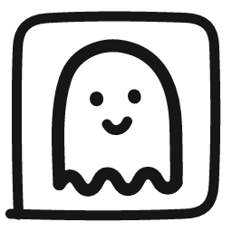
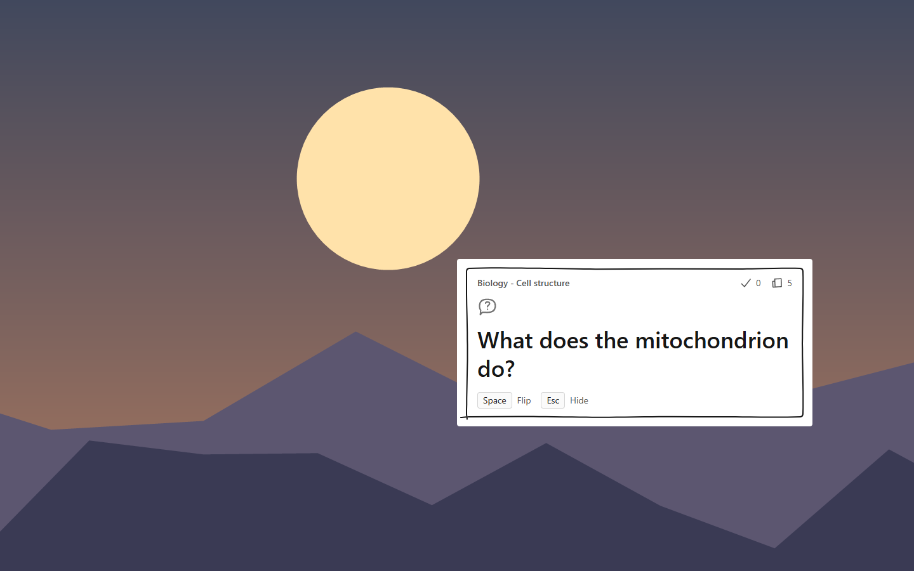
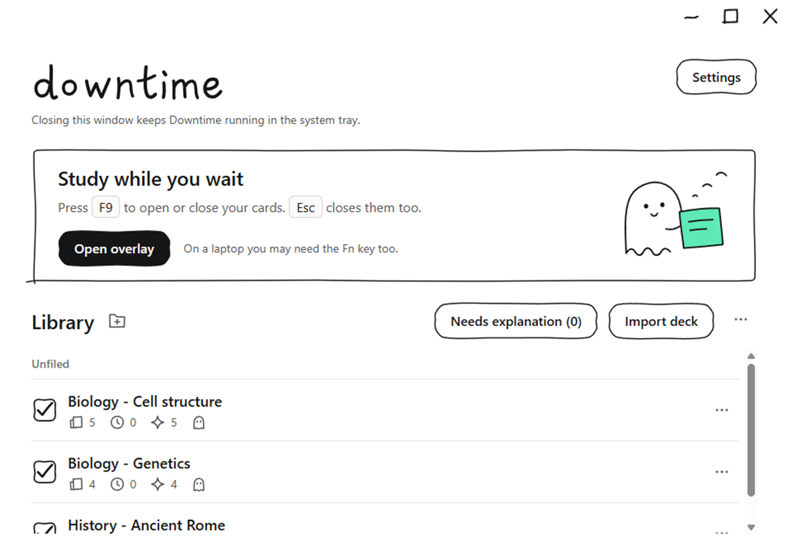
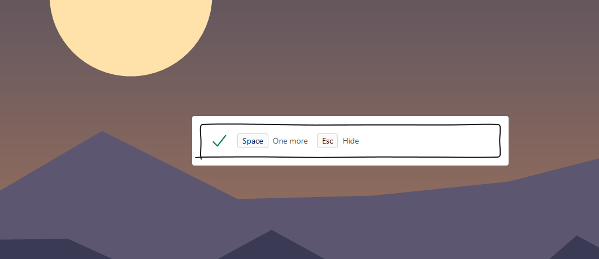
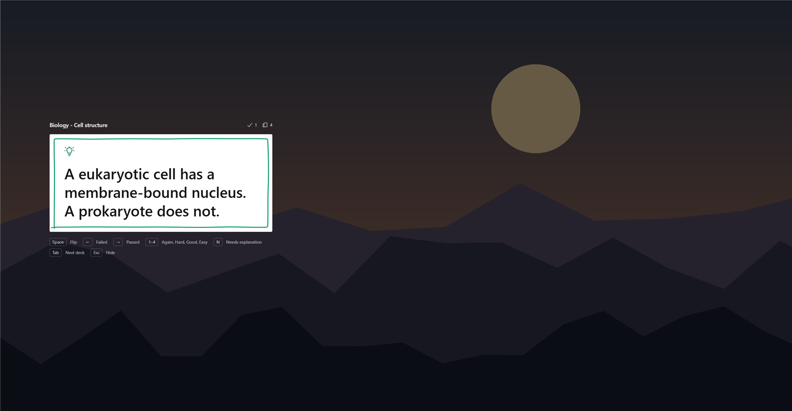
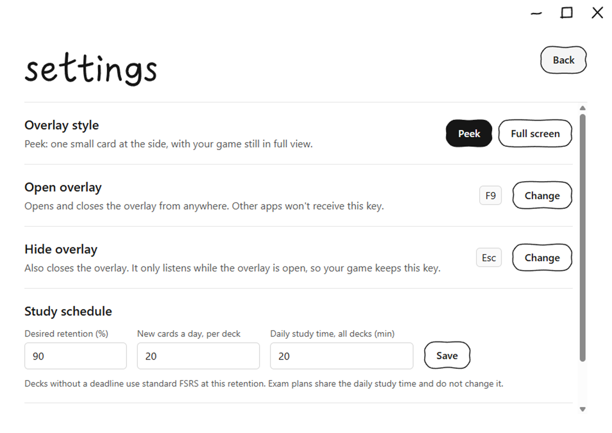

<div align="center">



# Downtime

**Flashcards for the downtime in your games.**

Dead with a minute to wait? Press a key, recall a card, and get back to the game.

[](https://github.com/dimslalom/downtime/releases/latest)

[](https://github.com/dimslalom/downtime/releases/latest)
[](https://github.com/dimslalom/downtime/actions/workflows/ci.yml)
[](LICENSE)



<sub>Peek keeps the round in view while you're dead. Captured over real Valorant footage, with player names blurred.</sub>

</div>

## Why

Competitive games are full of short gaps: queues, spectating, the rest of a round after you die. Those gaps are too short to open a textbook, and often too long to do nothing.

Downtime turns them into a few seconds of real recall. It stays out of the way until you ask for it, and it never decides for you when to study.

## Features

- **Peek:** one small card with no screen dim, so you can keep watching the round. Place it wherever your game leaves free.
- **One-handed:** flip and grade from the keyboard, without touching the mouse.
- **Picks up where you left:** hide the overlay mid-card and the same card comes back in the same state.
- **Real spaced repetition:** scheduling uses [FSRS](https://github.com/open-spaced-repetition/fsrs-rs), and it can personalise itself from your reviews.
- **Exam deadlines:** give a deck an exam date and Downtime plans your reviews around the time you have.
- **Bring your own decks:** decks are plain JSON files, so you can write them yourself or generate them with AI.
- **Stays on your PC:** there's no account, and your decks and reviews stay in local files.

## Download

**[Get the latest Windows installer](https://github.com/dimslalom/downtime/releases/latest)** and run the setup file.

Downtime needs 64-bit Windows 10 or 11. The installer isn't code-signed yet, so Windows may warn about an unknown publisher. If you want to check what you're running, you can [build it yourself](#build-from-source).

## How to use it

1. Open Downtime and add a deck, or try the Getting Started deck.
2. Set your game to **windowed fullscreen** or **borderless**. Exclusive fullscreen can hide the overlay.
3. When you have a moment, press the overlay key.

| Key | Action |
| --- | --- |
| <kbd>F9</kbd> | Open or close the overlay (you can change this) |
| <kbd>Esc</kbd> | Close the overlay (you can change this) |
| <kbd>Space</kbd> | Flip the card, or take one more |
| <kbd>←</kbd> | Failed |
| <kbd>→</kbd> | Passed |
| <kbd>1</kbd> to <kbd>4</kbd> | Again, Hard, Good, Easy |
| <kbd>N</kbd> | Flag a card as needing explanation |
| <kbd>I</kbd> | Show the card's source |
| <kbd>Tab</kbd> | Next deck |

On many laptops, function keys also need <kbd>Fn</kbd>.

## Screenshots

<table>
  <tr>
    <td width="50%"></td>
    <td width="50%"></td>
  </tr>
  <tr>
    <td align="center">Your library</td>
    <td align="center">After a grade, take one more or carry on</td>
  </tr>
  <tr>
    <td width="50%"></td>
    <td width="50%"></td>
  </tr>
  <tr>
    <td align="center">Prefer a bigger card? Use full screen</td>
    <td align="center">Choose your style and keys</td>
  </tr>
</table>

## Make your own decks

Drop a `.json` file into the decks folder and it loads without a restart. To find the folder, open the library's **...** menu and choose **Open decks folder**, or use **Import deck**.

```json
{
  "deck_name": "Biology - Cell structure",
  "cards": [
    { "front": "What does the mitochondrion do?", "back": "It produces most of the cell's ATP." }
  ]
}
```

To turn course notes into a deck, give an AI agent [the flashcard guide](docs/flashcard-agent-guide.md).

## The research behind it

Downtime's design leans on a few well-studied ideas. None of these studies tested gamers, so treat them as good reasons to try this approach, not proof that it works in a match.

- **Recalling beats rereading.** Testing yourself strengthens long-term memory more than studying the material again ([Roediger & Karpicke, 2006](https://doi.org/10.1111/j.1467-9280.2006.01693.x)). That's why a card asks before it shows the answer.
- **Waiting time can become learning time.** MIT's [WaitSuite](https://people.csail.mit.edu/ccai/publications/Cai_WaitSuite) offered vocabulary exercises during everyday waits, and people engaged most when the exercise was quicker to reach than the wait was long.
- **Optional beats intrusive.** Even in WaitSuite's best case, people took about 62% of the prompts, and exercises that could simply be ignored didn't feel disruptive. That's why Peek is small, and why it leaves the choice to you.
- **Spacing matters, and it can be scheduled.** Downtime uses [FSRS-6](https://github.com/open-spaced-repetition/fsrs-rs) to work out when each card is worth reviewing.
- **Game mechanics help motivation, not memory.** [A 2025 study](https://research-portal.uu.nl/en/publications/gamified-feedback-in-adaptive-retrieval-practice-points-and-progr/) found points and progress bars raised motivation without improving learning. Any scoring added here has to reward recall, not speed.

**Exam deadlines** were tested in [simulation](docs/simulation-results.md). Across nine scenarios, the planner beat ordinary FSRS on model-predicted exam recall, by about 3 points with plenty of time and over 20 with a short deadline. Those simulated learners follow FSRS itself, so this doesn't show the same gain for real people. The method is in [docs/deadline-mode.md](docs/deadline-mode.md).

## Status

Downtime is an early release, built around real play-testing in Valorant.

- **Manual only for now.** You open the overlay yourself. `overwolf-helper/` is an unfinished experiment with automatic triggers, and it isn't part of the app.
- **Game compatibility varies.** The overlay is an ordinary always-on-top window, so it can't draw over exclusive fullscreen.
- **Check your game's rules.** Downtime doesn't read game memory, and it gives no gameplay help. Even so, Riot's [VALORANT developer rules](https://developer.riotgames.com/docs/valorant) disapprove of static overlays that block parts of the map, so whether to use it, especially in ranked play, is your call.
- **Known bug.** If you open the overlay from Downtime's own window, focus can stay on the hidden overlay until you click something. Coming from a game works normally.

## Build from source

You need Windows, [Node.js](https://nodejs.org) 24, [Rust](https://rustup.rs) and the [Tauri prerequisites](https://tauri.app/start/prerequisites/).

```bash
git clone https://github.com/dimslalom/downtime.git
cd downtime
npm install
npm run tauri dev
```

Run `npm run tauri build` to make an installer. Built with [Tauri](https://tauri.app), React and Tailwind CSS.

## Contributing

Issues and pull requests are welcome. See [CONTRIBUTING.md](CONTRIBUTING.md).

## License

[MIT](LICENSE)

Downtime isn't affiliated with or endorsed by Riot Games, Blizzard Entertainment, Valve, Electronic Arts, Respawn Entertainment or Overwolf. Game names and the gameplay shown in the screenshots belong to their owners.
